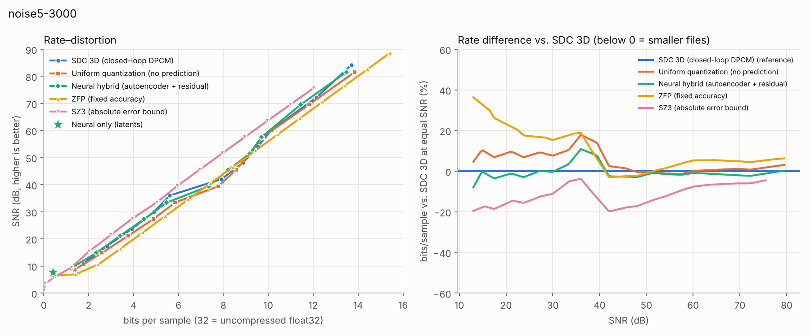

# Rate–distortion report

bits/sample over raw float32 samples (32 = uncompressed); SNR in dB on the original amplitudes.
External codecs (ZFP, SZ3) run in Python on exactly the same samples.

## noise5-3000 (128 × 128 × 1000)

### bits/sample needed to reach a target SNR (lower is better; — = outside the measured range)

| Codec | 15 dB | 20 dB | 25 dB | 30 dB | 40 dB | 50 dB | 60 dB |
|---|---:|---:|---:|---:|---:|---:|---:|
| SDC 3D (closed-loop DPCM) | 2.37 | 3.23 | 4.11 | 4.91 | 7.04 | 9.08 | 10.12 |
| Uniform quantization (no prediction) | 2.62 | 3.52 | 4.43 | 5.28 | 7.85 | 9.04 | 10.13 |
| Neural hybrid (autoencoder + residual) | 2.36 | 3.17 | 4.04 | 4.89 | 7.42 | 8.92 | 10.03 |
| ZFP (fixed accuracy) | 3.15 | 3.99 | 4.82 | 5.66 | 7.33 | 8.99 | 10.65 |
| SZ3 (absolute error bound) | 1.95 | 2.72 | 3.51 | 4.37 | 6.01 | 7.67 | 9.35 |

Neural only (latents, no residual): **0.419 bits/sample at 7.65 dB** (ratio 76:1).

### BD-rate (average bits/sample difference at equal SNR; negative = fewer bits)

| Codec | vs. SDC 3D | vs. uniform quantization | SNR range compared |
|---|---:|---:|---|
| Neural hybrid (autoencoder + residual) | -0.9% | -5.3% | 10.9–81.6 dB |
| Uniform quantization (no prediction) | +4.3% | — | 10.9–81.6 dB |
| ZFP (fixed accuracy) | +9.9% | +6.3% | 10.9–84.2 dB |
| SZ3 (absolute error bound) | -12.1% | -16.0% | 10.9–75.6 dB |

