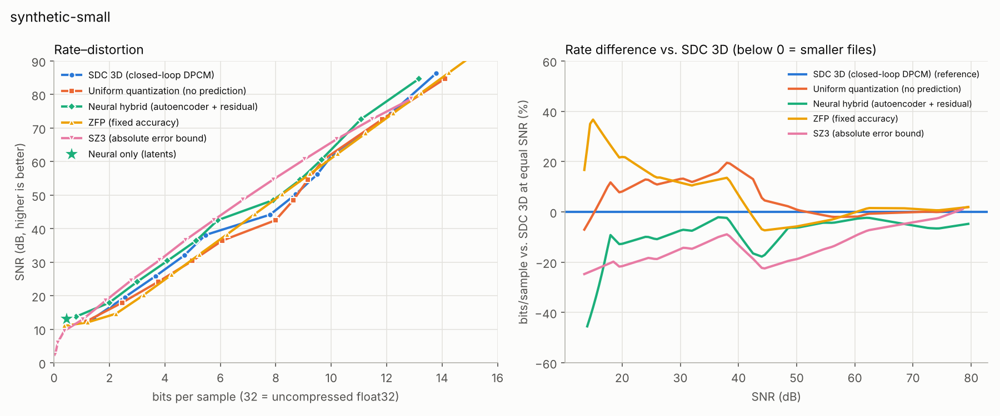
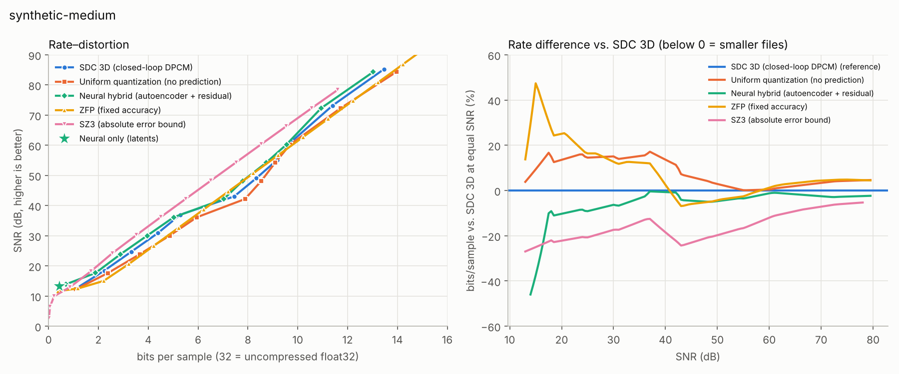

# Rate–distortion report

External codec libraries: zfpy 1.0.1, hdf5plugin 7.1.0, h5py 3.16.0, numpy 2.5.3.

bits/sample over raw float32 samples (32 = uncompressed); SNR in dB on the original amplitudes.
External codecs (ZFP, SZ3) run in Python on exactly the same samples.

## synthetic-small (32 × 32 × 500)

### bits/sample needed to reach a target SNR (lower is better; — = outside the measured range)

| Codec | 15 dB | 20 dB | 25 dB | 30 dB | 40 dB | 50 dB | 60 dB |
|---|---:|---:|---:|---:|---:|---:|---:|
| SDC 3D (closed-loop DPCM) | 1.67 | 2.62 | 3.49 | 4.33 | 6.10 | 8.68 | 9.85 |
| Uniform quantization (no prediction) | 1.66 | 2.83 | 3.91 | 4.90 | 7.13 | 8.76 | 9.67 |
| Neural hybrid (autoencoder + residual) | 1.04 | 2.28 | 3.13 | 4.01 | 5.57 | 8.14 | 9.57 |
| ZFP (fixed accuracy) | 2.29 | 3.19 | 4.01 | 4.83 | 6.51 | 8.18 | 9.83 |
| SZ3 (absolute error bound) | 1.28 | 2.05 | 2.84 | 3.69 | 5.30 | 7.05 | 8.90 |

Neural only (latents, no residual): **0.450 bits/sample at 13.13 dB** (ratio 71:1).

### BD-rate (average bits/sample difference at equal SNR; negative = fewer bits)

| Codec | vs. SDC 3D | vs. uniform quantization | SNR range compared |
|---|---:|---:|---|
| Neural hybrid (autoencoder + residual) | -8.6% | -12.9% | 13.8–84.7 dB |
| Uniform quantization (no prediction) | +4.9% | — | 13.3–84.7 dB |
| ZFP (fixed accuracy) | +5.4% | +0.8% | 13.3–86.4 dB |
| SZ3 (absolute error bound) | -13.6% | -17.9% | 13.3–78.7 dB |

## synthetic-medium (128 × 128 × 1000)

### bits/sample needed to reach a target SNR (lower is better; — = outside the measured range)

| Codec | 15 dB | 20 dB | 25 dB | 30 dB | 40 dB | 50 dB | 60 dB |
|---|---:|---:|---:|---:|---:|---:|---:|
| SDC 3D (closed-loop DPCM) | 1.49 | 2.47 | 3.37 | 4.22 | 6.27 | 8.46 | 9.63 |
| Uniform quantization (no prediction) | 1.63 | 2.80 | 3.86 | 4.85 | 7.12 | 8.70 | 9.67 |
| Neural hybrid (autoencoder + residual) | 0.93 | 2.21 | 3.06 | 3.95 | 6.23 | 8.06 | 9.51 |
| ZFP (fixed accuracy) | 2.20 | 3.09 | 3.92 | 4.75 | 6.43 | 8.09 | 9.75 |
| SZ3 (absolute error bound) | 1.12 | 1.92 | 2.67 | 3.48 | 5.11 | 6.79 | 8.47 |

Neural only (latents, no residual): **0.427 bits/sample at 13.25 dB** (ratio 75:1).

### BD-rate (average bits/sample difference at equal SNR; negative = fewer bits)

| Codec | vs. SDC 3D | vs. uniform quantization | SNR range compared |
|---|---:|---:|---|
| Neural hybrid (autoencoder + residual) | -5.7% | -12.2% | 13.9–84.4 dB |
| Uniform quantization (no prediction) | +7.4% | — | 12.6–84.4 dB |
| ZFP (fixed accuracy) | +7.1% | -0.4% | 12.6–85.2 dB |
| SZ3 (absolute error bound) | -16.3% | -22.4% | 12.6–78.4 dB |

